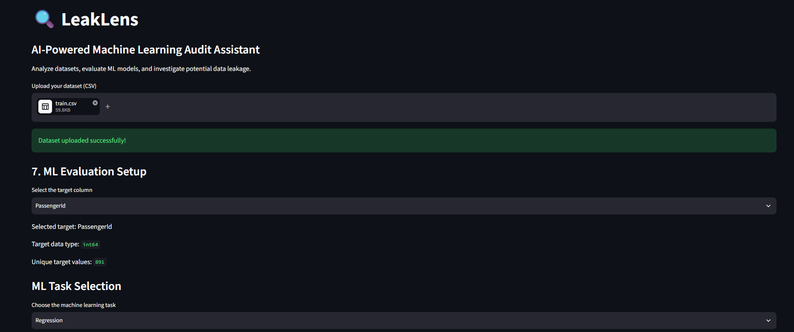
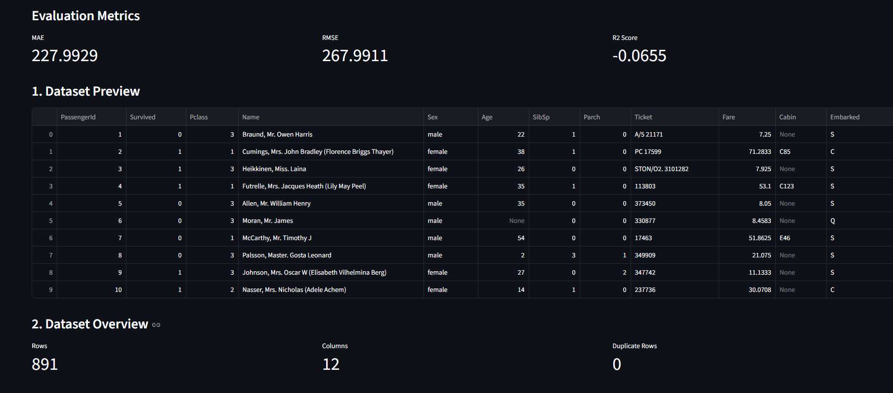

# LeakLens 🔍

**An ML Audit Assistant for Detecting Potential Data Quality Issues and Data Leakage**

LeakLens is a beginner-friendly machine learning audit tool that helps users inspect datasets, evaluate baseline models, and identify suspicious patterns that may indicate data leakage.

## 🚀 Features

- **Dataset Profiling:** Inspect dataset dimensions, missing values, duplicate records, and other data quality issues.
- **Target Selection:** Select the target column for machine learning evaluation.
- **Baseline Model Evaluation:** Train and evaluate a baseline classification or regression model.
- **Model Metrics:** View relevant evaluation metrics to understand model performance.
- **Potential Data Leakage Detection:** Flag suspicious features for further investigation.
- **Interactive Dashboard:** Explore dataset insights and model results through a Streamlit interface.

## 🛠️ Tech Stack

- Python
- Streamlit
- Pandas
- NumPy
- Scikit-learn
- Matplotlib / Seaborn (if used in the final code)

## 📁 Project Structure

```text
LeakLens/
├── app.py
├── modules/
│   ├── profiler.py
│   └── model_evaluator.py
├── requirements.txt
├── README.md
└── .gitignore
```

## ⚙️ Installation and Setup

### 1. Clone the repository

```bash
git clone YOUR_GITHUB_REPOSITORY_URL
cd LeakLens
```

Replace `YOUR_GITHUB_REPOSITORY_URL` with your actual repository URL.

### 2. Create a virtual environment

```bash
python -m venv .venv
```

### 3. Activate the virtual environment

**Windows PowerShell:**

```powershell
.\.venv\Scripts\Activate.ps1
```

### 4. Install dependencies

```bash
python -m pip install -r requirements.txt
```

### 5. Run the application

```bash
python -m streamlit run app.py
```

Open the local URL displayed in your terminal.

## 📸 Screenshots

### Dashboard


### Model Evaluation Results


Screenshots of the running application will be added here.

- Dataset profiling dashboard
- Model evaluation results
- Potential leakage warnings

## 🔬 How It Works

1. Upload a CSV dataset.
2. Inspect dataset quality and missing values.
3. Select the target variable.
4. Run baseline machine learning evaluation.
5. Review the performance metrics and potential leakage warnings.
6. Investigate suspicious features before trusting the model's results.

## ⚠️ Important Note

LeakLens identifies potential issues and suspicious patterns; its warnings do not prove that data leakage exists. Model performance alone is not sufficient to establish that a model generalizes well to unseen data.

## 🎯 Project Goal

The goal of LeakLens is to make basic machine learning auditing more accessible and encourage users to investigate data quality, evaluation methodology, and potential leakage before trusting model performance.

## 👨‍💻 Author

**Gaurav**

GitHub: YOUR_GITHUB_PROFILE_URL
